# SE73K 三模键盘运行机制图解

这份固件跑在 OM6239 上，给 USB、蓝牙、2.4G 各写了一个主循环，三者共用同一套按键扫描和灯效。`main()` 只做两件事：上电初始化，然后把控制权交给其中一个循环。

第一张图是整体流程，后面七张依次展开数据流、上电、三种模式、切换和休眠。

图例：蓝色是蓝牙，绿色是 2.4G，橙色是 USB，紫色是低功耗状态，红色是复位或异常路径，虚线表示当前源码里走不到或属于推断的路径。

## 先看结论

1. 切换模式就是一次软复位。拨动开关换档后固件调用 `NVIC_SystemReset()`，从 `main()` 重新走一遍，再按新档位进入对应模式。
2. 深睡唤醒也等于复位。区别在于 PMU 保持寄存器和 Flash 里的内容还在，所以 2.4G 能拿着旧同步字直接回连，蓝牙直接发回连广播。
3. 蓝牙有两级休眠：空闲 5 分钟进浅睡（连接不断），再过 15 分钟进深睡（连接断开）。2.4G 实际只有一级：空闲 5 分钟后，只要没在充电就直接深睡。
4. USB 模式的代码是完整的，但进入它的那段判断目前被注释掉了。按现在的源码，插上 USB 线只充电，键盘仍按拨动开关跑蓝牙或 2.4G。

## 1. 整体流程：从上电到休眠再回来

键盘的一生是一个环。复位后读一次拨动开关，进入对应模式的主循环；空闲久了逐级休眠；深睡被按键唤醒时芯片复位，又回到入口。换档和重新配对也是靠复位回到入口。

图 1　整体流程。三列结构相同：先建立连接，再进工作循环，空闲后浅睡。左侧红线是软复位，三种模式的工作循环都会这样回到入口，图里只画了蓝牙一条。

- 竖着看是一种模式的完整生命周期，横着看是三种模式在同一阶段的差别。
- 回到入口的路只有复位一条：拨动开关换档、长按配对键、深睡唤醒、蓝牙连接超时，走的都是它。
- USB 一列用虚线接入，因为当前源码里进入它的判断被注释了，详见最后一节。

## 2. 数据流：一份按键数据，三条出口

不管哪种模式，按键都先经过同一条流水线变成 HID 报文，放进 `std_key[]` 并在 `m_data_flag` 里置位。三种模式的区别只在两点：谁来打拍子触发扫描，报文从哪条通道发出去。

图 2　按键数据流。虚线表示 USB 出口在当前模板里走不到。主机的 Num / Caps 灯状态沿各自通道原路返回。

- 矩阵是 8 行 × 20 列：7 列由 GPIO 直接驱动，其余 13 列靠 P32 引脚打时钟的移位扩展逐列拉低（`projects/mouse_demo/periph/matrix_key.c:380`）。
- 每次按键变化，报文会连续发 8 次（`key_tx_count = 8`），无线下丢一两包也不会丢键。

## 3. 上电：从复位到进入某个模式

所有复位原因都走同一个入口。固件靠 `OM_RCC->RSTCTRL` 里的复位类型区分冷启动和热启动，冷启动把无线状态清零，热启动把上次留在保持寄存器里的状态接着用。

图 3　上电流程（`projects/mouse_demo/main/main.c:175-381`）。USB 一支用虚线画出，因为当前没有代码会把 `device_type` 设成 USB。

- 低压锁定：如果上次是因为电量耗尽关的机，按键把它唤醒后只闪一下低电灯就再睡回去，直到插上 USB（`main.c:215-233`）。
- 模式只由拨动开关决定。Flash 里其实存了上次的模式，但读取那一行被注释了（`projects/mouse_demo/flash/flash_process.c:189`）。
- 蓝牙模式下主频降到 12 MHz 省电，USB 和 2.4G 跑全速。

## 4. 2.4G：同步、收发、找不到接收器

2.4G 用 RTC 闹钟打拍子。连上接收器后每 4 ms 一拍：扫一次键，跳到下一个频点发一包，再周期性开接收窗口收接收器的应答，应答里带着电脑的 Num / Caps 灯状态。

图 4　2.4G 状态机（`mode_24g/main_24g.c`、`mode_24g/sleep.c`）。同步、对码、丢包判定的内部细节在闭源的 `rf_protocol.o` 里，虚线那条是按头文件推断的。

- 找不到接收器时模式灯慢闪，每 850 ms 重试一次同步；这期间有按键也会立刻重试。重试超过 10 轮且没在充电，就进深睡（`mode_24g/sleep.c:87-168`）。
- 对码只能在「找不到接收器」状态下进入：长按 Fn + 2.4G 键 3 秒，驻留 15 秒等接收器（`projects/mouse_demo/periph/userdefined_key_callback.c:418`）。
- 空闲计时在每次发包时刷新（`mode_24g/rf_data_process.c:231`），所以打字过程中不会误休眠。

## 5. 蓝牙：广播、连接、两级休眠

蓝牙跑在 exBLE2 协议栈上。启动时根据有没有「进入配对」标志，选择发可被发现的配对广播，还是只让老主机连的回连广播。连上后，协议栈在每个连接事件前调用应用层扫键。

图 5　蓝牙状态机（`projects/mouse_demo/main/ex2_app_mouse.c`、`projects/mouse_demo/main/mouse_hw.c`）。两个蓝牙通道各跑一份同样的流程，只是地址和设备名不同。

- 重新配对会换地址：长按配对键（蓝牙 1 是 1 秒，蓝牙 2 是 3 秒）后固件置位 `RSVD1_RF_CONN_EN` 并软复位，重启后把该通道的地址序号加 1。主机看到的是一个新设备，旧配对自然失效（`main.c:350-359`）。
- 浅睡时连接没断。按键触发 GPIO 中断，在中断里直接扫键并提前唤醒协议栈，所以第一个键不会丢（`hal/driver/om6239/drv_isr.c:117-137`）。
- 断线的三种处理：主机主动断开就直接去深睡；连接超时就软复位再回连；键盘自己断开就重启协议栈发回连广播（`mouse_hw.c:274-294`）。
- 充电中到了该深睡的时间不会深睡，而是停在浅睡里每 256 ms 醒一次刷新充电灯，此时按键会触发一次软复位。

## 6. USB：枚举、工作、挂起

USB 模式靠主机每 1 ms 发来的 SOF 包打拍子，每 4 个 SOF 扫一次键。电脑上的驱动软件通过 32 字节的 SET_REPORT 下发改键、灯效、休眠时间等配置，升级命令会让键盘跳进 Bootloader。

图 6　USB 流程（`mode_usb/main_usb.c`、`mode_usb/hal_usb_decs.c`）。USB 由总线供电，只进 STOP1，不进深睡。

- 挂起有两个来源：主机发了挂起信号，或者连续 5 秒收不到 SOF。之后再等约 6 秒才真正进浅睡。
- 远程唤醒要主机先下发 SET_FEATURE 允许。没允许的话，按键不会唤醒电脑，键盘只等总线自己恢复。

## 7. 切换模式会发生什么

三档拨动开关接在一个引脚上，固件用「先下拉读、再上拉读」的办法分辨接地、悬空、接电源三种状态。每拍扫键后都会检查一次，档位变了就软复位。

图 7　模式切换（`projects/mouse_demo/periph/matrix_key.c:554-666`）。切换没有「热切」路径，一律复位重来。

- 用户看到的现象：原来的连接立刻断开，模式灯换成新模式的灯，键盘自动去连新模式下上次配过的设备。切到 2.4G 时如果接收器在，通常几十毫秒内就能同步上。
- 各模式的配对信息互不影响：两个蓝牙通道的地址序号存在 Flash，2.4G 的同步字存在保持寄存器，来回切不需要重新配对。
- 切换前按住的键不会「卡住」：复位后 `std_key[]` 清零，新连接建立后发的是全松开的状态。

## 8. 休眠：三种模式各自的阶梯

休眠分两档。浅睡是 STOP1：主时钟停，RTC 还在走，RAM 保留，醒来接着跑。深睡是 DEEP_SLEEP：时钟全关，只留按键引脚唤醒，醒来等于复位。进深睡前固件把所有列线拉低、行线上拉，任意键按下都会在行线上产生下降沿。

图 8　休眠阶梯。时间是默认配置（0x25）查表得到的值，可以由驱动软件改写后存进 Flash。

| 模式 | 进浅睡 | 进深睡 | 浅睡时按键 | 深睡时按键 |
| --- | --- | --- | --- | --- |
| 2.4G | 空闲 5 分钟 | 紧接着（充电中除外） | 重新同步，不复位 | 复位，热启动后同步 |
| 蓝牙 | 空闲 5 分钟 | 再空闲 15 分钟（充电中除外） | 立即恢复，连接没断 | 复位，发回连广播 |
| USB | 主机挂起约 6 秒后 | 不进 | 远程唤醒电脑（需主机允许） | 不适用 |
| 低电 | 不适用 | 电量 0% 持续约 10 秒 | 不适用 | 闪低电灯后再睡，插 USB 才解除 |

- 没连上主机时也会睡：蓝牙广播超时没人连、2.4G 重试 10 轮找不到接收器，都直接进深睡。
- 浅睡和深睡都会关掉 ARGB 灯效和指示灯电源（`logo_off()`、`mLED_VDD_DIS`）。

## 读代码时发现的几处要留意

**USB 模式进不去。** `scan_mode_swtich()` 开头检测 5V 并切到 USB 的整段代码被注释了（`projects/mouse_demo/periph/matrix_key.c:559-602`），其他地方也没有把 `device_type` 设成 USB。结果是 `main_usb()` 永远不会被调用。要启用有线模式，需要恢复这段。

**「不复位直接切」是死代码。** 各主循环里都有 `bmode_swtich_valid` 为真就跳回 `main()` 的分支，但唯一把它置真的地方在上面那段注释里。现在所有切换都走软复位。

**第三个蓝牙通道没有入口。** 设备名表里有 `WK50_104BT3`，按键回调里也处理了 BT2，但拨动开关只能分辨三档，对应蓝牙 1、蓝牙 2、2.4G。

**默认休眠时间和注释不一致。** `projects/mouse_demo/flash/flash_process.c:272` 的注释写「1 分钟一级休眠，10 分钟深度休眠」，但默认值 0x25 查表（同文件 92-114 行）得到的是 5 分钟和 15 分钟。本文按查表结果写。

**蓝牙的空闲计时可能不随按键刷新。** 2.4G 每次发包都刷新 `rtc_init_value`，蓝牙这边在可见源码里只在进出休眠级别时更新。如果协议栈库里也没有刷新，连续打字满 5 分钟时灯效会闪灭一下。建议上板实测确认。

**两块闭源部分。** 2.4G 协议核心（`rf_protocol.o`）和蓝牙协议栈（`exble2` 库）没有源码。图里同步、对码、丢包重连的内部步骤是根据头文件和回调函数推断的。
